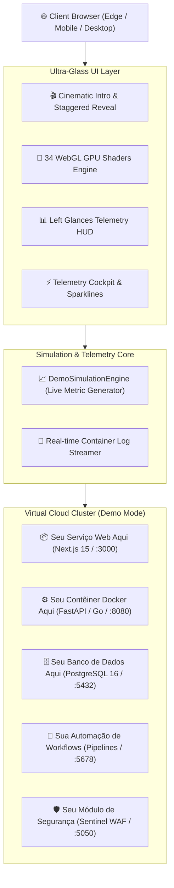

# MCP OS // Virtual Cloud Infrastructure & Live Telemetry Hub
### 🚀 Portfolio Demo Edition — Enterprise Software Engineering

[](https://vercel.com)
[](LICENSE)
[](https://webgl.org)
[](https://github.com/MateusCelestinoProX)

Uma suíte demonstrativa e interativa de controle de infraestrutura cloud, telemetria de alta frequência e orquestração de microsserviços conteinerizados, encapsulada em um **Design System proprietário Ultra-Light Translucent Glass** com aceleração gráfica WebGL em tempo real.

---

## 🌟 Destaques do Projeto

- **Cinematic Boot & Staggered Reveal:** Sequência de inicialização suave com checklist de subsistemas e transição em cascata para os cards e painéis operacionais.
- **Client-Side Simulation Engine:** Motor autônomo de telemetria hiper-realista que simula flutuações fisiológicas de CPU multicore (AMD EPYC 7763), memória RAM DDR4 ECC, IOPS de disco NVMe e tráfego de rede em streaming contínuo.
- **Glassmorphism de Alta Precisão:** Estética translúcida de vidro neutro com suporte a 34 shaders WebGL em GPU (Northern Aurora, 3D Particles, Ferrofluid, Liquid Chrome, Volumetric Beams, etc.).
- **Docker Cluster Inspector:** Visualizador interativo de contêineres em execução com modal de streaming de logs em tempo real e cópia para clipboard com um clique.
- **Zero-Exposure & Privacy-Preserved:** Ambiente sanitizado e blindado com substituição completa de dados proprietários por instâncias demonstrativas de alto impacto para portfólio.

---

## 🏗️ Arquitetura de Serviços Demonstrada



---

## 🕹️ Serviços e Placeholders Integrados

1. **Seu Serviço Web Aqui**
   - *Escopo:* Plataforma Web Full-Stack, Front-End moderno e Micro-Frontends.
   - *Stack:* Next.js 15, TypeScript, Tailwind CSS, Server Components.
   - *Métricas:* 2,480 req/s, 12.4ms latência P95, 99.99% uptime.

2. **Seu Contêiner Docker Aqui**
   - *Escopo:* Microsserviço de alta vazão e workers assíncronos.
   - *Stack:* Docker Alpine, FastAPI / Go, Redis Queue, IPC.
   - *Métricas:* 8/8 threads ativas, fila sem backlog, isolamento via cgroups.

3. **Seu Banco de Dados Aqui**
   - *Escopo:* Cluster relacional de dados e cache distribuído in-memory.
   - *Stack:* PostgreSQL 16, Redis 7, WAL Replicas, PgBouncer.
   - *Métricas:* 5,120 QPS, 99.8% cache hit ratio, 0.8ms latência.

4. **Sua Automação de Workflows Aqui**
   - *Escopo:* Orquestrador de pipelines contínuos, webhooks e agentes cognitivos.
   - *Stack:* Event-driven Orchestrator, Multi-Agent Gateway.
   - *Métricas:* 18 pipelines ativos, 14.8k execuções/dia, 99.94% taxa de sucesso.

5. **Seu Módulo de Segurança Aqui**
   - *Escopo:* Defesa perimetral, firewall inteligente e conformidade contínua.
   - *Stack:* Sentinel Shield, eBPF Kernel Probe, TLS 1.3, Zero-Trust.
   - *Métricas:* 0 ameaças ativas, inspeção de pacotes em 0.12ms, 100% integridade.

---

## 🚀 Execução Local Rápida

Como a demo é 100% client-side e autocontida, você pode rodá-la com qualquer servidor HTTP estático:

```bash
# Clone o repositório
git clone https://github.com/MateusCelestinoProX/mcp-os-vps-dashboard-demo.git
cd mcp-os-vps-dashboard-demo

# Usando Python
python3 -m http.server 3000

# Ou usando Node / npx serve
npx serve .
```

Acesse: `http://localhost:3000`

---

## ☁️ Deploy Imediato na Vercel

O projeto inclui o arquivo `vercel.json` pré-configurado com headers de segurança (HSTS, CSP, X-Frame-Options, Cache-Control otimizado). Para publicar:

```bash
vercel --prod
```

---

## 👤 Autor & Engenharia

Desenvolvido por **Mateus Celestino**  
GitHub: [@MateusCelestinoProX](https://github.com/MateusCelestinoProX)  
Email: [202405039459@alunos.estacio.br](mailto:202405039459@alunos.estacio.br)
